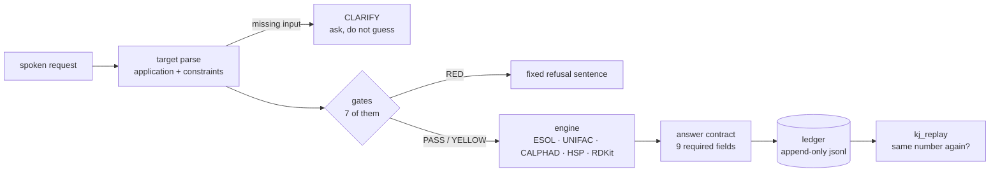

# 黒・実験 · kuro-jikken

> *jikken (実験) = experiment.* An open, reproducible lab notebook asking one narrow question:
> **when does an LLM agent get computational chemistry wrong, and how much do deterministic
> tools, gates and verification help?**


| | |
|---|---|
| **Author** | Yasin Yagci ([ORCID 0009-0001-3456-4299](https://orcid.org/0009-0001-3456-4299)), independent researcher |
| **Org** | [KuroShinHQ](https://github.com/KuroShinHQ) |
| **Stage** | Phase 1 done (locked solubility baseline, v0.1.1) · Phase 1b done (engine router) · Phase 2 (LLM A/B/C) pre-registered, **not run yet** |
| **Principle** | claim → evidence → publication. The LLM plans; numbers come only from tested tools. |

---

## 1. Research question

Given a small molecule (as a SMILES string), an LLM is asked for basic properties.
We compare three modes:

| Mode | Description |
|---|---|
| **A · Bare** | LLM answers from its own knowledge, no tools |
| **B · Tool** | LLM calls an RDKit-based tool (via MCP) and reports its output |
| **C · Tool + verify** | Same as B, plus an automatic check (parse, unit, range, re-compute) before the answer is accepted |

**Predictions** (to be frozen on OSF *before* any model is run):

- **P1.** Mode B has a lower error rate than Mode A.
- **P2.** Mode C has a lower error rate than Mode B.
- **P3.** Remaining errors in B/C are mostly *process* errors (tool not called, wrong SMILES
  passed, unit slip), not chemistry errors.

If the data contradict these predictions, that result gets published too.

## 2. Two layers

This repository is not only a molecule-property benchmark any more. It has two layers, and
they are deliberately separate:

| Layer | What it is | Status |
|---|---|---|
| **Baseline** | ESOL (Delaney 2004) aqueous logS on AqSolDB, locked evaluation, Zenodo v0.1.1 | published, numbers in §12 |
| **Router** | spoken request → capability → gate → engine → answer contract → append-only ledger | working, covered by tests |
| **Candidate pool** | 1294 Hansen entries + 18 melting entries + 3 CALPHAD phase lists, each with its licence | working, rebuildable |

The baseline says *how wrong a single model is*. The router says *which question may be
answered at all, by which engine, and how the number is reproduced later*.

## 3. How a request is answered

Every request walks the same five steps. No step may be skipped, and a refusal is produced
**before** any number is computed.



1. **Target** (`mcp/target.py`) — the spoken request becomes an application plus typed
   constraints. Every constraint keeps the exact text it came from (`span`), so a later
   audit can point at the sentence instead of trusting the parser.
2. **Gates** (`mcp/gates.py`) — seven applicability checks run before the engine. A gate
   can only return PASS, YELLOW or RED; a crashed gate is a RED, never a silent pass.
3. **Engine** (`mcp/engines.py`) — six capabilities are adapted: ESOL logS, UNIFAC
   gamma/gamma-infinity, CALPHAD melting/liquidus, wax melting range, binary VLE
   azeotrope (1 atm), RDKit identity.
4. **Answer contract** (`mcp/answer.py`) — a number must carry `value, unit, method, error,
   limits, verdict, provenance, reproduce, does_not_say`. Anything else is a refusal.
5. **Ledger** (`mcp/ledger.py`) — every call is appended to `runs/router/*.jsonl`;
   `kj_replay` recomputes the number and reports whether it is the same.

One call, end to end:

```
kj_ask("etanol suda ne kadar cozunur", {"smiles": "CCO"})
  -> GREEN  -0.1247458 log10(mol/L)   ledger 20261026T183546-48121adf
kj_replay("20261026T183546-48121adf")
  -> ok=true, value_same=true
```

## 4. What this repository will not answer

A RED row means: say "no engine for this", show the reason, and stop. Do not approximate a
RED request with a YELLOW engine.

| Request family | Verdict | Reason |
|---|---|---|
| toxicity, ADMET, LD50, carcinogenicity | RED | no engine |
| protein binding, docking, Kd | RED | no engine |
| TEWL, occlusivity, emulsion stability, skin feel | RED | no measurement, ranking would be fiction |
| azeotrope (binary, 1 atm) | GREEN / YELLOW | V1 engine (`mcp/vle.py`), validated on two binaries; other pairs are model predictions (`docs/VLE.md`) |
| vapour pressure, boiling point | RED | no pure-component Psat surface yet |
| petrolatum Hansen matching (CAS 8009-03-8) | RED | no Hansen record; no surrogate allowed (DEC-20261027-R4) |
| target with no recognisable application | CLARIFY | ask, never guess |

Refusals are not free text. `mcp/answer.py` has nine fixed classes, and a test pins each
sentence: `no engine` · `no data` · `out of domain` · `missing parameters` ·
`ambiguous name` · `unit mismatch` · `model != measurement` · `missing input` ·
`no azeotrope`.

## 5. Tools · two MCP servers (stdio)

There are two servers on purpose: the confirmatory experiment uses a frozen environment,
the physics engines need a different one.

| Server | Environment | Exposes |
|---|---|---|
| `mcp/server.py` | `.venv` (frozen) | `parse_smiles`, `formula`, `molecular_weight`, `heavy_atom_count`, `ring_count`, `hbd_lipinski`, `hbd_plain`, `hba_lipinski`, `hba_plain`, `esol_predict` — **10 tools** |
| `mcp/tools_server.py` | `.venv_inventory` | `alloy_melting_point`, `hsp_lookup`, `hsp_distance`, `hsp_rank`, `unifac_groups`, `unifac_gamma`, `unifac_gamma_infinity`, `kj_ask`, `kj_replay`, `kj_recipe` - **10 tools** |

The ten property tools return `value`, `unit`, `method`, `rdkit_version` and a matched
`error_bar`. The router answers (`kj_ask`) go further and must carry the full contract from
§3 — including `provenance`, `limits`, `reproduce` and `does_not_say`. `in_domain` means:
neutral, single-component, no metal, MW ≤ 500, no phosphorus (~1.2 log units; salts,
mixtures and metals are ~5 log units, from the locked-set report).

### Install (two environments, do not mix them)

```powershell
# 1) frozen experiment environment: RDKit + ESOL server
python -m venv .venv
.venv\Scripts\python -m pip install -r requirements.txt
.venv\Scripts\python mcp\server.py

# 2) physics engines: CALPHAD + Hansen + UNIFAC + router
python -m venv .venv_inventory
.venv_inventory\Scripts\python -m pip install mcp==2.3.0 pint pycalphad chemicals thermo ugropy rdkit numpy pandas pyarrow
.venv_inventory\Scripts\python mcp\tools_server.py
```

`tools_server.py` **cannot** run inside `.venv`: it imports `chemicals`, `thermo` and
`pycalphad`, which the frozen environment must not receive.

CALPHAD databases are **not** in this repository. They live outside (default
`C:\KuroshinHQ\_hub\data\alloy_tdb_mgf`, override with `KJ_TDB_DIR`) because MatCalc open
databases are ODbL-1.0 + DbCL-1.0 (share-alike). Never commit them here.

## 6. Calibration policy (why only two properties may be ranked)

`data/calibration.json` is the single place that decides what a number is allowed to claim.
Nine entries, checked by `tools/calibration_check.py`:

| Status | Count | Meaning |
|---|---|---|
| `CALIBRATED` | 2 | measured error against a locked set: ESOL logS, Dortmund UNIFAC gamma-infinity |
| `MEASURED_NOT_DECLARED` | 2 | error measured but not yet declared as a capability: COSMO-SAC, CALPHAD |
| `UNCALIBRATED` | 3 | wax melting range, logP, VLE azeotrope (2-point check only) — usable as a bound, never as a ranking |
| `REFERENCE_ONLY` | 1 | Hansen parameters: context, not a sort key |
| `DEFINITION` | 1 | molecular weight: exact by definition |

Rules that follow from the ledger:

- a number may not exist without a gate verdict;
- a ranking may not exist without a `CALIBRATED` property — `screen.validate()` enforces it;
- a RED capability may not be replaced by a surrogate (this is why petrolatum has no HSP);
- every number carries its error and the dataset that produced it.

## 7. Reproducibility rules

1. Every number in `results/` can be regenerated by one documented command.
2. Raw outputs in `runs/` are append-only; the router ledger is append-only too.
3. Data files carry source, retrieval date, version and unit (`data/manifest.json`,
   built by `tools/build_manifest.py`; a dataset outside the manifest is not read).
4. Tools have unit tests and pass known-answer checks before any model run.
5. Predictions are committed and registered **before** results exist.
6. A refusal is data: the fixed sentence, the gate reason and the ledger id are recorded.

## 8. Repository layout

```
kuro-jikken/
├── README.md · CITATION.cff · LICENSE · CHANGELOG.md · AGENTS.md
├── data/            # molecule list, reference values, SCHEMA.md, manifest.json
│   ├── pool/        # 1294 Hansen + 18 melting + 3 CALPHAD phase lists + licences
│   └── solubility/  # AqSolDB (CC0), exclusions, source notes
├── mcp/             # 2 servers + router: target, gates, engines, answer, ledger, screen
├── tools/           # engines and CLIs: calibration_check, build_pool, screen, vertical_slice,
│                    #   alloy_liquidus, wax_melting, unifac_gamma, ask, replay_router
├── bench/           # LLM A/B/C harness (modes, prompts, scoring, id lists)
├── scripts/         # preflight, TDB normaliser, prompt-cache check
├── runs/            # raw model outputs + router ledger (append-only)
├── validation/      # known-answer tests, tool vs PubChem deviations
├── results/         # tables, figures, error analysis
├── prereg/          # frozen predictions (mirrored on OSF)
├── docs/            # notes and decisions: ENGINE_ROUTER_PLAN, CALIBRATION, PETROLATUM,
│                    #   S5_PETROLATUM_SLICE, ROADMAP_20261027, DATA_INVENTORY
└── site/            # small interactive menu (legacy)
```

`AGENTS.md` states how an agent answers a plain request here, and what each engine refuses.
Where a document and a live test disagree, the live test wins.

## 9. Run it, verify it

```powershell
.venv_inventory\Scripts\python -m pytest -q                          # 523 passed
.venv_inventory\Scripts\python tools\calibration_check.py --strict  # exit 0, 2 rankable
.venv_inventory\Scripts\python tools\build_pool.py --check          # 5 files match a fresh build
.venv_inventory\Scripts\python tools\vertical_slice.py --check      # exit 0 (document is current)
.venv_inventory\Scripts\python mcp\screen.py "Vazelin benzeri cilt koruyucu" --limit 5
.venv_inventory\Scripts\python mcp\vle.py ethanol water             # 351.40 K, x = 0.894
```

The screen command is the shortest end-to-end demonstration: target → pool → calibration →
ranked list, with a gate trace on every row and the refusal boundary printed under it
(`docs/S5_PETROLATUM_SLICE.md` is the rendered version). The VLE line is the second:
two names → gate → Dortmund UNIFAC + Psat → a number with an error bar (`docs/VLE.md`).

## 10. Scope and safety

Only common, harmless molecules are used. No toxins, pathogens, weapons-relevant chemistry,
synthesis routes or wet-lab protocols are in scope, and none will be published here.
Simulation outputs are **hypotheses, not proof**. This repo makes no medical, cosmetic or
therapeutic claims.

## 11. Use of AI assistance (disclosure)

Parts of the code and text were drafted with AI assistants (a coding agent and a chat
assistant). The research question, design decisions, predictions, and interpretation are the
author's responsibility; AI-generated code is reviewed and covered by tests. Commit history
shows when and what changed.

## 12. Results so far

First locked evaluation, 2026-10-25:

| Group | validation RMSE | locked-set RMSE | status |
|---|---|---|---|
| all data (pre-registered primary) | 2.23 | 2.14 | red, but stable |
| in-domain (neutral, single-component, MW<=500) | 1.222 | 1.225 | green, matches literature |
| salts / mixtures | 4.56 | 5.27 | red |
| metal-containing | 4.55 | 4.99 | red |

Recomputed from the ledger on 2026-10-27: in-domain n=1917 RMSE **1.2246**, out-of-domain
n=482 **4.0989**, all n=2399 **2.1387**. The 1.2 bar is an in-domain claim and is quoted as
such.

Secondary result (amendment, accepted): the in-domain group view was decided after seeing
validation results; the pre-registered all-data result above remains the primary result.
Nothing was deleted or recomputed away.

### Limitations

- The pre-registered plan and lock value were committed with timestamps before the
  evaluation ran; OSF registration came after `--final`, so this round has no external
  pre-registration record. Rule for the next round: OSF registration BEFORE any model run.
- The MCP tool's `in_domain` flag excludes phosphorus; the locked-set metric did not
  separately exclude phosphorus.
- Domain grouping is exploratory, not blind: the authors saw validation numbers before
  writing prediction P1-P4 (recorded as such).
- This is a reproducible baseline with a published linear model (ESOL, Delaney 2004), not a
  discovery and not yet an LLM benchmark; the LLM A/B/C experiment has NOT started.
- Router-side limits: Hansen parameters are reference-only; wax melting is an ideal SLE
  bound (YELLOW, no activity coefficients); CALPHAD reports a bisection bracket, not a full
  error model; the melting pool has 18 entries, so a screen result is "best of the scanned
  slice", not "best of chemistry".

## 13. Roadmap

- [x] Phase 0: identity and infrastructure (ORCID, Zenodo, OSF)
- [x] Phase 1: dataset, RDKit tool + tests, pre-registration, locked solubility baseline
- [x] Phase 1b: engine router (gates, answer contract, ledger, replay), calibration ledger,
      candidate pool, `screen()` with a refusal boundary
- [ ] Phase 2: model runs, error analysis, preprint (Zenodo, then arXiv) — OSF 8pbnu is
      public and approved; the confirmatory run has not started
- [ ] Phase 3: outside feedback, issues, collaboration
- [ ] Phase 4 (>= 6 months public history): software paper submission

Working plan with per-item acceptance evidence: `docs/ROADMAP_20261027.md`.

## 14. Cite

See `CITATION.cff`. Each tagged release receives a Zenodo DOI.
Pre-registration artifacts: OSF project https://osf.io/kjye6
(registrations: `8pbnu` for the LLM A/B/C plan, `uce8d` for the solubility feature).
The OSF upload came after the first evaluation — see Limitations.
Cite the latest version via the concept DOI 10.5281/zenodo.23633858.
v0.1.0 (https://doi.org/10.5281/zenodo.23633859) is superseded.
v0.1.1 DOI: https://doi.org/10.5281/zenodo.23638653

---

### 🇹🇷 Kısa özet

Bu repo, "LLM'ler hesaplamalı kimyada ne zaman yanlış yapar, araç ve doğrulama bunu ne kadar
azaltır?" sorusunu açık ve tekrarlanabilir şekilde ölçer. Sayıları LLM değil, test edilmiş
araçlar üretir. Üstüne bir **motor yönlendirici** eklendi: soru önce hedefe ve kısıtlara
ayrılır, sonra yedi **kapıdan** geçer, ancak kapsam içindeyse motor hesaplar ve sayı
`birim + hata + limit + defter kimliği` ile birlikte döner. Sıralama yalnız **kalibre edilmiş
iki özellikte** (logS, gamma-sonsuz) yapılır; cevap verilemeyen her soru için sabit bir ret
cümlesi vardır, uydurma sayı yoktur. Yalnızca zararsız, bilinen moleküller kullanılır.
Tahminler sonuçlardan önce kaydedilir; tahminler tutmasa da sonuç yayınlanır.
